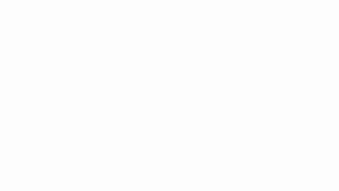
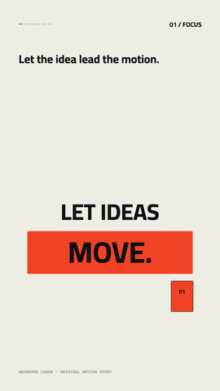

# animated logos

A portable Agent Skill and local motion toolkit for **Codex, Claude Code, Google Antigravity, and Gemini CLI**. Assemble a symbol, move it into its lockup, stagger the original wordmark, and finish on the exact master artwork.

**مهارة لتحريك الشعارات**: تجميع الرمز، ضبط السرعة والارتداد، وتحريك الحروف مع حفظ الشعار الأصلي. تعمل بالكود داخل Blender، وتضم مسار تصدير JSX تجريبي إلى After Effects.


The project identity above combines **orbit** for the symbol and **wipe** for the wordmark. It is a real rendered animation. [MP4 and editable source](examples/project-identity).

| Assembly | Orbit | Pop |
| --- | --- | --- |
|  |  |  |
| Fold | Glitch | Wipe |
|  |  |  |

Previews: [clean](examples/clean/preview.mp4) · [restrained](examples/restrained.mp4) · [elastic](examples/elastic.mp4). The [clean example](examples/clean) includes its SVG/PNG layers, timeline, experimental JSX, and editable Blender file.

## Arabic kinetic motion

**حركة الكتابة العربية من المرجع إلى الكود:** تركيز، قصّ الكلمات، مدّ الوصلة مع حفظ الحروف، تحويل الأشكال، كاميرا بين الطبقات، وعدّاد متحرّك.



[Play the MP4](examples/arabic-kinetic/preview.mp4) · [Open the editable example](examples/arabic-kinetic/) · [How the six techniques work](skills/animated-logos/references/arabic-kinetic.md) · [Reference breakdown](docs/arabic-kinetic-study.md).

This original 18-second study uses an optional **Canvas2D** renderer. Arabic is shaped first, then a suitable baseline connector is extended; morphs use matching contours; camera layers use perspective projection; the digit counter has an exact endpoint. It renders from explicit time with existing Node/Playwright/Chromium and FFmpeg. The supplied reference recording, its soundtrack and creator artwork are not bundled. The Blender logo renderer and its six motion families remain available independently.

## What is included

- A discoverable skill named `$animated-logos`, with reference-led design guidance.
- Six symbol families and six independently selectable wordmark treatments; combine them with `--family` and `--wordmark`.
- Three parameter profiles: clean, restrained, elastic. The default assembly/drop behavior remains compatible with v0.1.0.
- Looping, palette-optimized GIF export for documentation and sharing.
- Deterministic motion samples shared by the Blender builder and an experimental AE JSX exporter.
- Original NOVA demo artwork, rendered previews, endpoint checks and relative-path project validation.
- Six Arabic kinetic-motion recipes, a runnable Canvas study and browser/geometry checks.
- No customer brand assets, voice recordings, paid API integrations or bundled third-party course material.

The skill stores reusable working knowledge and executable tools. It does not retrain an AI model. Blender is the verified logo pipeline; Canvas2D is checked for the Arabic kinetic study. AE export remains experimental until executed and reviewed in After Effects.

## Install for your agent

```sh
git clone https://github.com/mohamedkbay/animated-logos.git
cd animated-logos
python3 tools/install.py --target codex
```

Choose `--target claude`, `antigravity`, `antigravity-cli`, or `gemini` for another agent; `--target all` installs for every listed agent. It copies only the skill, not the demos, caches or repository. Use `--project-root PATH` for a project-scoped install or `--skills-dir PATH` for a configured legacy/custom location. Existing identical files are left as they are; changed installations require `--update`, which preserves a timestamped backup. Start a new session or refresh skill discovery after installation.

| Agent | Global destination | Invoke |
| --- | --- | --- |
| Codex | `~/.agents/skills/animated-logos` | `$animated-logos` or ask by name |
| Claude Code | `~/.claude/skills/animated-logos` | `/animated-logos` |
| Antigravity App / IDE | `~/.gemini/config/skills/animated-logos` | `/animated-logos` or ask by name |
| Antigravity CLI | `~/.gemini/antigravity-cli/skills/animated-logos` | `/animated-logos` |
| Gemini CLI | `~/.gemini/skills/animated-logos` | Ask to use `animated-logos`; `/skills list` checks discovery |

These locations were checked against [OpenAI's skill documentation](https://learn.chatgpt.com/docs/build-skills), [Claude Code](https://code.claude.com/docs/en/skills), [Antigravity](https://antigravity.google/docs/skills), and [Gemini CLI](https://geminicli.com/docs/cli/skills/) on 2026-10-27. The standard skill package and installer support these discovery layouts. Runtime validation so far covers the local Python/Blender/Chromium pipeline; full agent sessions on Claude, Antigravity and Gemini have not been exercised.

Antigravity's Gemini model uses the same installed skill; no model-specific API key is needed by this toolkit. The agent host's own account and access requirements still apply. A browser chat with no local Blender/terminal access can use the design guidance but cannot run this local renderer.

Example request:

> Use $animated-logos to animate this logo in the style of my reference, with a clean 1080p preview and an editable Blender project.

> استعمل animated logos، حرّك شعاري بتجميع الرمز وبعدها الحروف، وخلي النهاية مطابقة للشعار الأصلي.

## Run a demo

The toolkit uses existing Python 3.10+, Blender, Node/Playwright and Chromium, plus FFmpeg for MP4. Pillow is used for review sheets and image checks. It does not install or download dependencies.

If needed, install the pinned helper dependencies in a project-local environment you choose: `npm install` for Playwright and `python3 -m pip install -r requirements-qa.txt` for Pillow. Blender, FFmpeg and a Chromium browser are separate prerequisites. The animation scripts use the existing browser executable and do not download browser binaries. See `package.json` and `requirements-qa.txt` for the versions used in validation.

See [the production commands](skills/animated-logos/references/pipeline.md), [motion choices](skills/animated-logos/references/motion-design.md), and [After Effects mapping and primary sources](skills/animated-logos/references/after-effects.md).

Mix two techniques and export a GIF after rendering/encoding:

```sh
python3 skills/animated-logos/scripts/animated_logos.py demo --project work/orbit-wipe --family orbit --wordmark wipe
# Rasterize, render and encode using the production commands linked above.
python3 skills/animated-logos/scripts/animated_logos.py gif --input work/orbit-wipe/preview.mp4 --output work/orbit-wipe/preview.gif
```

## Library research and original implementation

The reviewed [VideoHive logo catalogue](https://videohive.net/category/after-effects-project-files/logo-stings) advertises over **19,600 After Effects logo stings**, the largest explicitly counted logo-specific collection verified in this review. This is not a claim of global rank. [Research notes and licensing sources](skills/animated-logos/references/catalog-research.md) compare Envato, Motion Array and Mister Horse.

The included motions are independently written implementations of general techniques. No commercial template, preset expression, footage or soundtrack is bundled. The [motion library](skills/animated-logos/references/motion-library.md) explains each family, combinations and current renderer limits.

## Check the project

```sh
python3 -m unittest discover -s tests -v
node --check skills/animated-logos/scripts/rasterize.cjs
```

See [validation](skills/animated-logos/references/validation.md) for real render and relocation checks. The [v0.3.0 validation report](docs/validation-report.json) records this update; [v0.2.0](docs/v0.2.0-validation.json) and the [initial report](docs/v0.1.0-validation.json) retain earlier Blender evidence.

## License and contribution

Original code and demonstration artwork are MIT licensed. Embedded Cairo font data in the project identity example is separately licensed under SIL OFL 1.1; see [THIRD_PARTY_NOTICES.md](THIRD_PARTY_NOTICES.md). NOVA is demonstration material, not a claim of brand ownership or availability. Bring logo assets you have permission to use. Improvements should include a reproducible example or a meaningful check; keep customer logos, voice recordings, credentials and local machine paths outside contributions. See [CONTRIBUTING.md](CONTRIBUTING.md).
