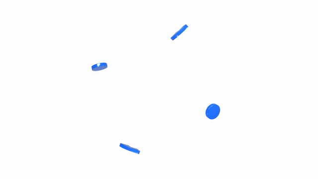

# Tag Tech — Connected Assembly

A ten-second logo ident made with the **animated-logos** workflow: four dimensional pieces assemble, settle into the supplied flat symbol, move into the lockup, and reveal the original wordmark. Original synchronized sound effects accompany the contacts and reveals.



[Play the 1080p MP4 with sound](preview.mp4) · [Editable Blender scene](tag-tech-assembly.blend) · [Timing and sound cues](plan.json) · [Validation](validation.json)

**Identity design: Yasin Alsharif.** Brand artwork was supplied by the repository owner, who requested this public example. It is excluded from the toolkit's MIT license; see [asset rights](LICENSE-ASSETS.md). This is a motion study, without an affiliation or endorsement claim.

## Motion sequence

| Time | Action |
| --- | --- |
| 0–3.3 s | Two discs and two stepped arcs orbit, tilt, and gather in polished blue 3D. |
| 3.3–4.65 s | The rig settles front-on, then transitions to the supplied flat icon. |
| 4.75–5.75 s | The icon shrinks and travels into the final lockup. |
| 5.85–6.78 s | Tag and Tech reveal through separate masks with a small rise. |
| 6.73–7.2 s | A restrained highlight crosses the icon. |
| 7.2–10 s | The unsplit supplied master holds exactly, with no fade-out. |

The supplied artwork is raster. The 3D geometry is an interpretation of its four shapes; the settled 2D identity and lettering come from the actual supplied bitmap, not a replacement font. The uncompressed final compositor frame is pixel-identical to `assets/final-master.png`. H.264 and GIF compression can change pixels in their encoded outputs.

## Rebuild locally

Use existing **Blender, Python 3.10+, Node.js, Playwright, Chromium, FFmpeg, and FFprobe**. This example downloads nothing and uses no paid API. The checked environment used Blender 5.2.3 LTS, Node 24, Playwright 1.62.1, Chrome and FFmpeg 8.1.2. Other versions have not been verified.

From the repository root, install the pinned Node helper dependencies only if they are missing (`npm install`). Then run:

```sh
# Save the editable 300-frame scene and render the 141-frame dimensional phase.
blender --background --python examples/tag-tech/build_scene.py -- \
  --project examples/tag-tech --render

# Generate the original, seeded 48 kHz stereo effects using only Python's stdlib.
python3 examples/tag-tech/sound.py

# Composite all 300 frames and encode a new 1920×1080 MP4 with audio.
node examples/tag-tech/render.cjs \
  --project examples/tag-tech --output work/tag-tech/preview-v2.mp4 \
  --browser /path/to/your/chromium

# Export a silent, looping documentation GIF with the skill's existing tool.
python3 skills/animated-logos/scripts/animated_logos.py gif \
  --input work/tag-tech/preview-v2.mp4 --output work/tag-tech/preview-v2.gif \
  --width 640 --fps 15 --duration 10
```

Replace executable placeholders with paths on your machine. On macOS Blender's executable is usually inside the application bundle. When Playwright is outside the repository, add `--playwright-module /absolute/path/to/node_modules/playwright`. Optional `--ffmpeg PATH` and `--ffprobe PATH` select existing binaries. The output must be a new filename; the encoder refuses to overwrite one. Use `--width 960` for a quick 16:9 preview. Final rendering expects full-resolution CG frames from the default Blender command.

`tag-tech-assembly.blend` contains the dimensional phase's camera, lighting, four objects and baked animation over a 300-frame scene. Its render path is relative. Wordmark compositing and audio are performed by `index.html`, `render.cjs` and `sound.py`; the Blender file alone does not contain that final composite. Generated `cg-frames/`, `review-*`, and WAV caches are deliberately excluded from Git.

The Canvas renderer samples explicit time, without recording wall-clock browser playback. The command supplies artwork as local data URIs and blocks HTTP requests. Review PNGs are saved every three frames. Inspect the moving interval, the 3D-to-flat transition and the unsplit endpoint before delivery.

## Sound and checks

Air sweeps, resonant pings, short contacts and a three-note resolving accent are synthesized from a fixed seed. They are original procedural effects, not recorded glass or commercial samples. No source-video audio, voiceover or music is included. GIF has no sound; use the MP4.

`validation.json` records the actual 1080p frame count, duration, decode result, endpoint comparison, looping GIF check and encoded loudness. Visual review used contact sheets at 0.1-second intervals and selected full-resolution frames. Audio was checked by signal measurements and cue timing; human listening review is not claimed.

Example agent request:

> Use $animated-logos and the Tag Tech example to create a ten-second dimensional assembly from my supplied logo. Preserve my original wordmark, finish on the unsplit master, synthesize restrained synchronized effects, render a small preview first, and verify the 1080p MP4 and GIF. Credit the original identity designer and keep asset rights separate from toolkit code.
